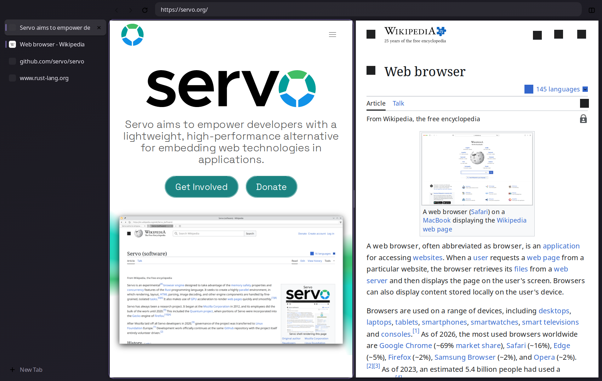
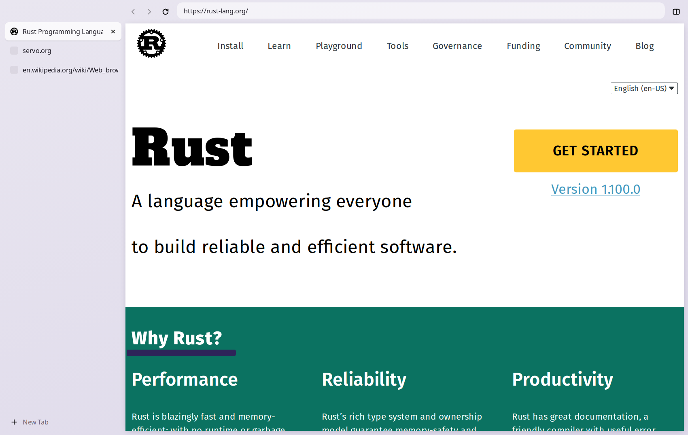

<p align="center">
  
</p>

<h1 align="center">Drift</h1>

<p align="center">
  A calm, Zen-inspired web browser built on <a href="https://servo.org">Servo</a>.
</p>

<p align="center">
  <a href="https://github.com/xRookieFight/drift/actions/workflows/ci.yml"></a>
  <a href="https://github.com/xRookieFight/drift/releases"></a>
  <a href="LICENSE"></a>
</p>

---

Drift is a browser that tries to get out of your way. Tabs live in a quiet sidebar, pages sit on a soft rounded card, and two tabs can share the window in split view. The whole interface is plain HTML and CSS drawn by Servo itself, so theming it is just writing CSS.

> [!WARNING]
> Drift is young and so is Servo. Many sites work well, some render incorrectly or not at all. Please report broken sites with the site compatibility template.

## Showcase

<p align="center">
  
</p>

<p align="center">
  
</p>

Captured from the real app with `drift --screenshot`. The black squares on Wikipedia are icons Servo cannot draw yet.

## Features

- Vertical tabs in a sidebar, with the address bar and navigation built in
- Split view with two tabs side by side and a draggable divider
- Address bar and navigation in a slim top bar, with its own window controls
- A floating address panel with history suggestions and site name completion
- History page with search
- Workspaces and essentials (pinned tabs shown in every workspace)
- Compact mode that hides the chrome until you reach for it
- File uploads through your desktop's own file chooser
- Light and dark themes that follow the system
- Session restore
- Built in updates from GitHub Releases, verified before they are installed
- Keyboard first: <kbd>Ctrl</kbd>+<kbd>T</kbd>, <kbd>Ctrl</kbd>+<kbd>W</kbd>, <kbd>Ctrl</kbd>+<kbd>Shift</kbd>+<kbd>T</kbd>, <kbd>Ctrl</kbd>+<kbd>L</kbd>, <kbd>Ctrl</kbd>+<kbd>H</kbd>, <kbd>Ctrl</kbd>+<kbd>Tab</kbd>, <kbd>Ctrl</kbd>+<kbd>1</kbd>…<kbd>9</kbd>, <kbd>Ctrl</kbd>+<kbd>Shift</kbd>+<kbd>S</kbd>

See the [roadmap](#roadmap) for what comes after.

## Install

Grab the tarball or the AppImage from the [releases page](https://github.com/xRookieFight/drift/releases).

From the tarball, install for your user (no root needed):

```sh
tar xf drift-*-x86_64-linux.tar.gz && cd drift-*-x86_64-linux
./install.sh ./drift
```

Drift checks for new releases once a day and offers to update itself from the sidebar. Updates are verified against the release's SHA256SUMS before they replace anything. Start with `--no-update-check` to turn that off.

## Build from source

Drift targets Linux first. You need a recent stable Rust toolchain and the native libraries Servo depends on.

On Fedora:

```sh
sudo dnf install gcc-c++ clang clang-libs llvm cmake libtool gperf python3-devel \
  libX11-devel libXi-devel libXrandr-devel libXcursor-devel libXmu-devel \
  libxkbcommon-devel wayland-devel mesa-libGL-devel mesa-libEGL-devel vulkan-loader \
  freetype-devel fontconfig-devel harfbuzz-devel expat-devel glib2-devel dbus-devel \
  libunwind-devel ncurses-devel libjpeg-turbo-devel \
  gstreamer1-devel gstreamer1-plugins-base-devel gstreamer1-plugins-bad-free-devel
cargo run --profile local    # optimized build without LTO, quicker to relink
```

The first build compiles all of Servo, so expect it to take a while and use around 20 GB of disk.

If you would rather not install the -devel packages, build inside the build environment image. The binary in target/local then runs on any Fedora host that has the runtime libraries:

```sh
scripts/cargo-in-container.sh build --profile local
target/local/drift
```

## Roadmap

| Version | Focus | |
|---------|-------|---|
| 0.1 | Sidebar tabs, split view, theming, session restore, updates | done |
| 0.2 | Custom title bar, floating address panel, history | done |
| 0.3 | Workspaces, essentials, compact mode, file uploads | done |
| next | Downloads (waiting on a Servo API), Flatpak | |

## Contributing

Contributions are welcome. Read [CONTRIBUTING.md](CONTRIBUTING.md) first, and please follow the [Code of Conduct](CODE_OF_CONDUCT.md). Security issues go through [SECURITY.md](SECURITY.md), not public issues.

## Acknowledgements

Drift stands on [Servo](https://github.com/servo/servo), and its look is inspired by [Zen Browser](https://zen-browser.app). Drift is an independent project and is not affiliated with either.

## License

[Mozilla Public License 2.0](LICENSE)
